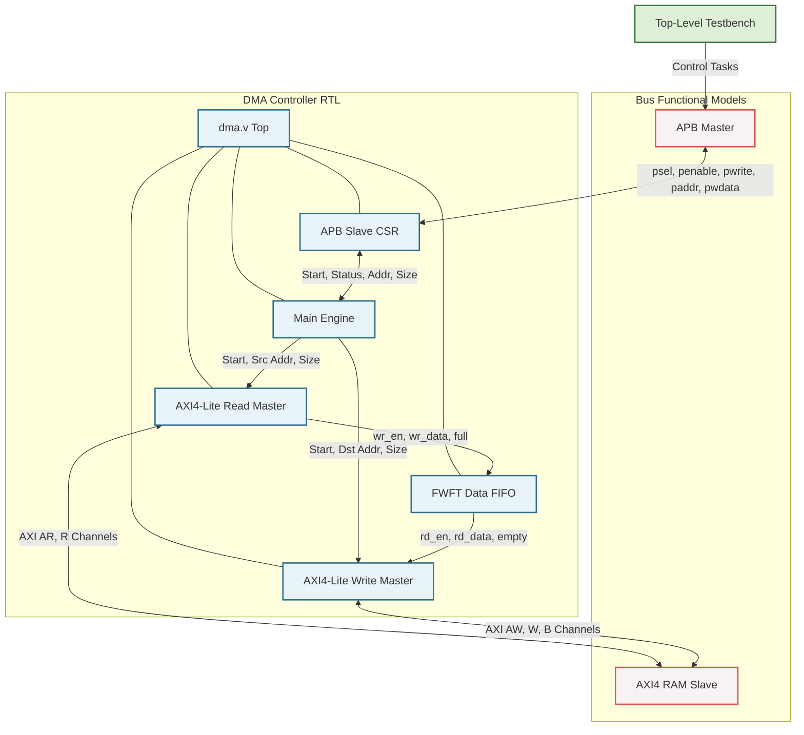

# Direct Memory Access (DMA) Controller Design

## Project Overview
This repository contains the RTL design and verification environment for a custom **Direct Memory Access (DMA) Controller**. The DMA controller is designed to efficiently move blocks of data from a source memory address to a destination memory address without CPU intervention, maximizing system throughput.

This project was developed as part of a System-on-Chip (SoC) design curriculum and showcases practical experience with standard bus protocols (AMBA APB and AXI4-lite) and high-performance hardware design techniques.

## Key Features
- **AMBA APB Slave Interface**: Used for configuring Control and Status Registers (CSRs).
- **AMBA AXI4-Lite Master Interface**: Handles high-speed memory-mapped read and write transactions.
- **Overlapping Read/Write Architecture**: Achieves high throughput by decoupling read and write operations using an internal FIFO buffer, allowing simultaneous AXI read and write phases.
- **Synchronous FIFO**: An internal 4-word deep (`DEPTH_LOG2=2`), First-Word Fall-Through (FWFT) FIFO designed for seamless data buffering between the AXI read and write masters.
- **FSM-Based Control**: Robust Finite State Machines governing the APB interface, AXI Read Master, AXI Write Master, and the Main DMA Engine.

## Hardware Architecture

The system is partitioned into modular blocks for clarity and maintainability. Below is the block diagram of the DMA Controller and its verification environment.



### Module Descriptions:
1. **`dma.v`**: The top-level wrapper module that instantiates and connects all the internal submodules.
2. **`dma_apb_slave_csr.v`**: Decodes APB transactions to program the source, destination, and transfer size. It also reports the current status (busy/done) back to the CPU.
3. **`dma_main_engine.v`**: The central coordinator. It receives start pulses from the CSR, distributes configuration to the AXI masters, and tracks overall completion.
4. **`dma_axi_read_master.v`**: Initiates AXI `AR` and `R` channel transactions to fetch data from memory and pushes it into the FIFO.
5. **`dma_axi_write_master.v`**: Pops data from the FIFO and initiates AXI `AW`, `W`, and `B` channel transactions to store data into the destination memory.
6. **`dma_axi_fifo.v`**: Parameterizable FIFO (instantiated with a depth of 4 words) bridging the Read and Write masters to enable pipelined data movement.

## Control and Status Registers (CSR)

The DMA is configured via a 32-bit APB bus. The register map is 4-byte aligned:

| Register Name        | Address | R/W | Description |
|----------------------|---------|-----|-------------|
| **Control**          | `0x00`  | R/W | **[31:16]**: Transfer size in bytes (up to 64KB). <br> **[15:1]**: Reserved. <br> **[0]**: Start bit (Write `1` to trigger DMA). |
| **Status**           | `0x04`  | RO  | **[1]**: Done bit. Set when transfer finishes. <br> **[0]**: Busy bit. Set while DMA is active. |
| **Source Address**   | `0x08`  | R/W | 32-bit aligned source memory address. |
| **Destination Addr** | `0x0C`  | R/W | 32-bit aligned destination memory address. |

**Programming Sequence:**
1. Write the source memory address to `0x08`.
2. Write the destination memory address to `0x0C`.
3. Write the size and set the start bit to `0x00` (e.g., `0x01000001` for a 256-byte transfer).
4. Poll the Status register at `0x04` until the `Done` bit is set and `Busy` is cleared.

## Verification Environment
The design is verified using a pure Verilog testbench (`dma_top_tb.v`). 
* **BFMs Provided**: A behavioral `apb_master` is used to simulate CPU configuration tasks, and an `axi4_ram_slave` (64KB) acts as the system memory.
* **Test Cases**: Verifies various transfer sizes (e.g., 64 bytes, 256 bytes) and ensures absolute data integrity by performing auto-checking (comparing source and destination memory regions) at the end of the simulation.

### Running the Simulation
To run the simulation, you will need a standard Verilog simulator (e.g., ModelSim, VCS, or Icarus Verilog).

## Simulation & Synthesis (Cadence EDA Flow)

This project is built and verified using industry-standard Cadence EDA tools. A configured `Makefile` is provided to automate RTL simulation (Xcelium), logic synthesis (Genus), and logic equivalence checking (Conformal).

### RTL Simulation (Cadence Xcelium)

The simulation flow consists of the following steps:

**Compile RTL files:**

```bash
make compile
```

**Elaborate the testbench:**

```bash
make build
```

**Run RTL simulation:**

```bash
make run
```

**Run simulation and launch the waveform viewer (Cadence SimVision):**

```bash
make wave
```

### Logic Synthesis (Cadence Genus)

```bash
make syn
```

### Logic Equivalence Checking (Cadence Conformal)

```bash
make lec
```

**Note:** Ensure your Cadence environment and license paths are properly sourced before running the commands.

*Expected Output:*
```text
[TB] Starting DMA Test
[PASS] DMA transferred and verified 64 bytes from 00000000 to 00008000.
[PASS] DMA transferred and verified 256 bytes from 00004000 to 0000c000.
[ALL PASS] All test cases passed.
```
